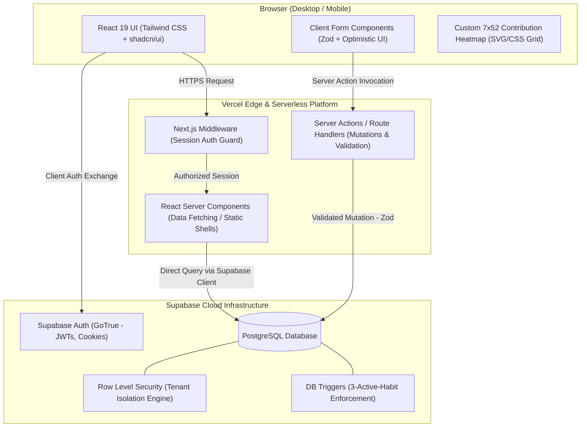

# 🌿 Progress Garden

> **"Change the definition of success: You don't have to finish a habit today; you just have to move it forward."**

Progress Garden is an anti-streak, micro-effort habit tracking web application. Rather than punishing users with broken streaks and arbitrary resets, Progress Garden focuses on incremental momentum: logging small decimal efforts (like 15 minutes of reading or 0.5 study sessions) and visualizing cumulative growth through custom contribution heatmaps.

---

## ✨ Core Pillars

- **Anti-Streak Philosophy:** Every bit of effort counts. Missing a day doesn't reset your progress to zero.
- **The 3-Habit Constraint:** Enforced focus—users maintain a maximum of 3 actively cultivated habits at any given time to eliminate overwhelm.
- **Micro-Effort Precision:** High-precision decimal logging (e.g. `0.25 hrs`, `1.5 miles`) with zero floating-point accumulation drift.
- **Dynamic Heatmap Visualization:** 52-week calendar heatmaps displaying effort intensity curves scaled relative to daily targets.
- **Strict Data Isolation:** Multi-tenant PostgreSQL security powered by Supabase Row Level Security (RLS) policies.

---

## 🏛️ High-Level System Architecture

Progress Garden is built as a monolithic Next.js application powered by Supabase (PostgreSQL + Auth), deployed to Vercel's edge network:

---

## 🛠️ Technology Stack

| Layer | Technology |
|---|---|
| **Framework** | Next.js (App Router, Server Actions) |
| **Language** | TypeScript |
| **Frontend** | React 19, Tailwind CSS, shadcn/ui, Lucide Icons |
| **Database & Auth** | Supabase (PostgreSQL, GoTrue, Row Level Security) |
| **Validation** | Zod (End-to-end schema validation) |
| **Hosting & CI/CD** | Vercel Serverless & Edge |

---

## 🎯 7-Phase Implementation Roadmap

- [ ] **Phase 1: Project Foundation & Tooling**
  - Initialize Next.js (App Router, TypeScript, Tailwind CSS, ESLint).
  - Install and configure `shadcn/ui` components & design tokens.
  - Setup environment variable templates (`.env.example`).
  - Deploy initial shell to Vercel to verify CI/CD pipeline.
- [ ] **Phase 2: Authentication & Route Protection**
  - Setup Supabase project and `@supabase/ssr` client package.
  - Build Auth flow (`/login`, `/signup`, `/auth/callback`, password recovery).
  - Configure Next.js Middleware to protect `/dashboard`, `/habits/*`, and `/settings`.
  - Validate session persistence across browser refreshes.
- [ ] **Phase 3: Database Schema & Security Hardening**
  - Run the SQL migration scripts (`profiles`, `habits`, `progress_entries`).
  - Implement the transactional 3-active-habits check trigger.
  - Apply Row Level Security (RLS) policies for complete tenant isolation.
  - Test cross-account isolation: verify User A cannot read or modify User B's entries.
- [ ] **Phase 4: Habit Management (CRUD)**
  - Build the habit creation form with target value and custom unit selection.
  - Implement active habit listing on `/dashboard`.
  - Build the edit habit and archive habit mutations.
  - Verify strict server-side rejection if a user attempts to activate a 4th habit.
- [ ] **Phase 5: Effort Logging & History Engine**
  - Implement the quick log modal / sheet (decimal amount, date picker, optional notes).
  - Add date validation (prevent logging future dates if disallowed, support past dates).
  - Build the cumulative effort calculation engine (`Total`, `% Complete`, `Remaining`).
  - Create the chronological history feed with entry editing and deletion.
- [ ] **Phase 6: The Progress Heatmap & Visual Polish**
  - Construct the 52-week (7 rows x 52 columns) contribution calendar grid.
  - Implement the target-relative daily intensity color scale (Levels 0 to 4).
  - Add hover tooltips showing date, logged amount, and notes.
  - Ensure mobile responsiveness (horizontal scrolling or responsive card view).
  - Build polished empty states and loading skeletons.
- [ ] **Phase 7: Testing, Production Launch & DNS**
  - Write Vitest unit tests for progress calculation and heatmap aggregation logic.
  - Write Playwright E2E tests for the core user journey (signup -> habit -> log effort -> heatmap).
  - Link custom domain on Vercel and configure DNS records.
  - Review Supabase free tier inactivity mitigation and backup procedures.

---

## 💡 Core Engineering Principles

1. **The Database is the Source of Truth:** Never compute or trust cumulative progress or user IDs in the browser. Compute totals on the server or in SQL queries.
2. **Decimal Precision Matters:** Progress is measured in increments like `0.167` hours (10 minutes) or `0.5` sessions. Never use standard floating-point numbers without rounding; use PostgreSQL `NUMERIC` and controlled precision.
3. **Isolate Multi-Tenancy at the Schema Level:** Every progress entry must match the owning user _and_ the owning habit's user. Do not rely solely on UI filtering.
4. **Build Incrementally:** Complete and test one layer before starting the next. A solid database with working Server Actions beats a flashy UI with broken backend logic every single time.
